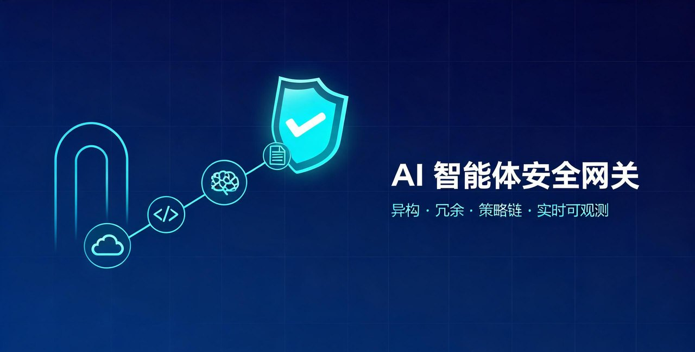

# AI 智能体安全网关

> 面向大语言模型（LLM）交互场景的**异构、冗余**内容安全检测网关。
> 通过统一的 REST API 编排多来源、多形态的检测模型，以策略链方式对 AI 应用的输入/输出进行安全检测。

[English](README_EN.md) | 简体中文

---

## 目录

- [项目简介](#项目简介)
- [特色功能](#特色功能)
- [架构概览](#架构概览)
- [快速开始](#快速开始)
- [API 使用示例](#api-使用示例)
- [配置说明](#配置说明)
- [数据大屏](#数据大屏)
- [目录结构](#目录结构)
- [测试](#测试)
- [技术栈](#技术栈)
- [文档](#文档)
- [合规使用声明](#合规使用声明)
- [免责声明](#免责声明)
- [致谢](#致谢)
- [许可](#许可)

---

## 项目简介

AI 智能体安全网关是一个面向生产环境的 LLM 交互安全检测网关，提供检测能力管理、策略编排、策略链执行、实时可观测与数据大屏等能力。AI 应用只需调用统一的 `POST /guard{path}` 接口，即可在请求大模型前（输入检测）或获得回复后（输出检测）完成内容安全校验。

系统以**管理后台 + 对外检测 API + 数据大屏**三部分组成：

- **管理后台**：配置检测模型、安全标签、编排策略与对外检测路径，配置即时生效、无需重启。
- **对外检测 API**：统一入口、API Key 认证、自定义拦截状态码，便于与 Higress 等 AI 网关及业务系统集成。
- **数据大屏**：基于 WebSocket 实时推送检测事件，可视化策略链与各检测模型的判定过程。

## 功能

- **异构（Heterogeneous）**：同一策略可挂载异构来源的检测能力 —— 标准 REST 检测服务（自研 HTTP 接口）、本地大模型经 Python 脚本封装的 REST 服务（见 [guardrail/](guardrail/)）、以及内联 Python 脚本，统一纳管、混合编排。
- **冗余（Redundant）**：
  - **顺序检测（sequential）**：逐个调用模型池中的检测能力，任一判定不安全即快速失败、终止后续调用，兼顾延迟与检出率；
  - **随机检测（random）**：从可相互替代的冗余模型池中随机选取一个调用，以确定的低成本获得不确定的防护面，提升攻击者的绕过难度。
- **策略链编排**：一个对外路径可按序绑定多条策略（如：个人信息 → 越狱攻击 → 不当言论），任一策略不通过即拦截。
- **实时可观测**：完整的请求级日志与模型调用级日志（含耗时），WebSocket 实时事件推送，内置数据大屏与统计视图。
- **网关生态集成**：提供适配 [Higress](https://higress.io/) AI 网关的 Go/Wasm 插件（见 [plugins/](plugins/)），可在网关侧无感接入本网关。

## 架构概览

```
┌─────────────┐
│  AI 应用    │ ──请求──▶  ┌────────────────────────────────┐
│ (集成方调用)│            │      AI 智能体安全网关网关       │
└─────────────┘            │                                │
                           │  ┌─────────────────────────┐  │
                           │  │  策略链 (按顺序执行)     │  │
                           │  │  ├─ 策略1 (顺序/随机)    │  │
                           │  │  │   ├─ 模型A (REST)     │  │
                           │  │  │   ├─ 模型B (脚本)     │  │
                           │  │  │   └─ 模型C (REST)     │  │
                           │  │  ├─ 策略2 (顺序/随机)    │  │
                           │  │  └─ 策略3 (顺序/随机)    │  │
                           │  └─────────────────────────┘  │
                           │                                │
                           │  ◀── 可观测日志 + 大屏推送      │
                           └────────────────────────────────┘
                                       │
                                       ▼
                                  PostgreSQL
```

### 核心概念

- **安全标签**：检测能力分类，如「个人信息检测」「越狱攻击检测」。系统内置 6 类标签，支持自定义。
- **检测模型**：外部或自定义的安全检测服务，可绑定多个标签；支持 REST 接口与 Python 脚本两种接入方式。
- **策略**：针对某一标签的检测模型集合及调用规则（顺序检测 / 随机检测），含最长等待时间与单模型超时策略。
- **API 路径（检测场景）**：对外暴露的检测接口，可按序绑定多条策略（策略链）并绑定 API Key。

## 快速开始

### 环境要求

- Python 3.10+
- Node.js 20+
- Docker（可选，用于容器化部署）

### 本地开发（前后端同时启动）

```bash
# 1. 克隆项目
git clone <repo-url>
cd ai-agent-gateway

# 2. 一键构建（安装后端依赖 + 编译前端）
bash scripts/build.sh

# 3. 启动开发服务器（后端 8000 + 前端 5173）
bash scripts/start.sh
```

访问地址：

- 管理后台：http://localhost:5173
- API 文档（Swagger UI）：http://localhost:8000/docs
- 数据大屏：http://localhost:5173/#/dashboard

默认管理员账户：`admin` / `admin123`（请在生产环境中立即修改）。

### Docker 一键部署（推荐生产环境）

```bash
# 1. 复制并编辑配置（数据库密码、SECRET_KEY、管理员密码等）
cp .env.example .env
vim .env

# 2. 一键部署（构建镜像 + 启动 PostgreSQL 与网关容器）
bash scripts/deploy-docker.sh
```

访问地址：http://localhost:8000 （管理后台、API 文档、数据大屏同端口）

## API 使用示例

### 对外检测接口

集成方通过统一的 `POST /guard{path}` 接口调用，路径在管理后台「检测场景」中配置。

**请求示例**

```bash
curl -X POST http://localhost:8000/guard/chat-input \
  -H "Content-Type: application/json" \
  -H "X-API-Key: gk_xxxxxxxxxxxxxxxxxxxxxxx" \
  -d '{
    "messages": "用户输入的内容",
    "jsonpath": "",
    "illegal_status_code": 200
  }'
```

**请求参数**

| 字段 | 类型 | 必填 | 说明 |
|------|------|------|------|
| `messages` | string | 是 | 被检测的消息（纯文本，或配合 `jsonpath` 使用的 JSON 字符串） |
| `jsonpath` | string | 否 | 从消息中提取检测内容的 JsonPath；为空时检测整条消息 |
| `illegal_status_code` | int | 否 | 检测不通过时返回的 HTTP 状态码，默认 `200`（由响应体业务码区分） |

**响应示例（安全）**

```json
{
  "code": 200,
  "risk_level": "NONE",
  "message": "检测通过，未发现安全风险",
  "risk_type": ""
}
```

**响应示例（不安全）**

```json
{
  "code": 4030,
  "risk_level": "HIGH",
  "message": "内容包含敏感词",
  "risk_type": "个人信息检测"
}
```

业务码说明：

| `code` | 含义 |
|--------|------|
| `200` | 检测通过（安全） |
| `4030` | 检测到风险（不安全） |
| `4001` | JsonPath 内容提取失败（消息不是合法 JSON 或路径无匹配） |

HTTP 状态码取决于请求中的 `illegal_status_code` 参数；鉴权失败返回 `401`，路径未生效或密钥禁用返回 `403`，路径不存在返回 `404`。

### 管理后台 API

管理接口需 JWT 认证：登录后获取 token，请求头携带 `Authorization: Bearer <token>`。详见 API 文档：http://localhost:8000/docs 。

## 配置说明

### 环境变量

本地开发配置模板位于 [backend/.env.example](backend/.env.example)；Docker Compose 部署使用根目录 [.env.example](.env.example)。

| 变量 | 说明 | 默认值 |
|------|------|--------|
| `GATEWAY_HOST` | 监听主机 | `0.0.0.0` |
| `GATEWAY_PORT` | 监听端口 | `8000` |
| `DATABASE_URL` | 数据库连接串 | `sqlite:///./guardrail.db` |
| `SECRET_KEY` | JWT 签名密钥 | **生产环境务必修改** |
| `ACCESS_TOKEN_EXPIRE_MINUTES` | 登录令牌有效期（分钟） | `720` |
| `ADMIN_USERNAME` | 默认管理员用户名 | `admin` |
| `ADMIN_PASSWORD` | 默认管理员密码 | `admin123` |
| `OBSERVABILITY_LEVEL` | 可观测级别（debug/basic/statistics） | `basic` |
| `CORS_ORIGINS` | 允许的跨域来源 | `*` |
| `POSTGRES_USER` / `POSTGRES_PASSWORD` / `POSTGRES_DB` | Docker 部署的 PostgreSQL 账户与库名（见根目录模板） | `guardrail` / 见模板 |

> **生产环境安全提醒**：上线前请务必替换默认管理员密码 `admin123` 与弱 `SECRET_KEY` 占位符，并将 `CORS_ORIGINS` 从 `*` 收敛为指定域名。

### 接入检测模型

#### REST 接口方式

1. 在「检测能力」中新建模型，选择「REST 接口」；
2. 填写接口地址、请求方法、请求头与请求体模板（`{content}` 占位符会被实际检测内容替换）；
3. 配置安全判定条件：响应状态码等于指定值，且/或响应体 JsonPath 提取值与期望字符串相等（不区分大小写）；
4. 配置不安全提示信息的提取路径（JsonPath）；
5. 点击「有效性检测」验证连通性。

请求体模板示例：

```json
{
  "text": "{content}"
}
```

#### Python 脚本方式

1. 新建模型，选择「Python 脚本」；
2. 脚本约定：定义 `detect(content)` 函数，返回 `(code, message)`；`code == 0` 表示安全，其他值表示不安全，`message` 为不安全时的提示信息；
3. 脚本在独立子进程中执行并设置超时，与主服务进程隔离。

> **安全提醒**：脚本会被实际执行，请确保仅由可信管理员提交，以防任意代码执行风险。

```python
def detect(content):
    if "敏感词" in content:
        return 1, "内容包含敏感词"
    return 0, ""
```

> 将本地开源检测模型（如 Qwen3Guard、Llama Prompt Guard）封装为 REST 服务的示例脚本，请参见 [guardrail/](guardrail/) 目录。

## 数据大屏

大屏通过 WebSocket（`/ws/dashboard`）实时推送四类检测事件：`request_received`、`strategy_start`、`strategy_result`、`final_result`，展示：

- 累计统计与近 7 日趋势、风险类型分布；
- 实时交互流（AI 应用 ⇄ 网关 ⇄ 策略链 ⇄ 检测模型）；
- 策略链与各模型逐个判定的执行过程；
- 事件流水（请求到达、策略执行、最终结果）。

访问：本地开发 http://localhost:5173/#/dashboard ；Docker 部署 http://localhost:8000/#/dashboard 。

## 目录结构

```
.
├── backend/                  # 后端（FastAPI + SQLAlchemy）
│   ├── app/
│   │   ├── api/              # 路由控制器
│   │   ├── core/             # 配置、数据库、认证安全
│   │   ├── models/           # ORM 模型
│   │   ├── schemas/          # Pydantic 模型
│   │   ├── services/         # 模型调用器、策略引擎、网关编排、事件广播
│   │   └── main.py           # 应用入口
│   ├── scripts/smoke_test.py # 端到端冒烟测试
│   └── requirements.txt
├── frontend/                 # 前端（Vue 3 + Vite + Pinia + ECharts）
│   └── src/
│       ├── api/  components/  router/  stores/  styles/  views/
├── guardrail/                # 检测模型 REST 化 Python 脚本（Qwen3Guard / Prompt Guard）
│   ├── qwen3-guard.py
│   ├── meta-prompt-guard.py
│   ├── start-all.sh / stop-all.sh
│   └── README.md
├── plugins/                  # 适配 AI 网关的插件
│   └── higress/              # Higress Go/Wasm 插件
│       └── content-security-guard/
│           └── README.md
├── scripts/                  # 一键构建、启动、Docker 部署脚本
├── docs/                     # 架构设计与集成指南
├── Dockerfile                # 多阶段构建单镜像
├── docker-compose.yml        # PostgreSQL + 网关编排
└── .env.example              # Docker 部署环境变量模板
```

## 测试

```bash
cd backend
python3 scripts/smoke_test.py
```

冒烟测试覆盖：登录认证、模型管理与有效性检测、策略编排、API 路径与 API Key、检测流程（安全/不安全/JsonPath 提取失败）、可观测统计与日志等核心流程。

## 技术栈

- **后端**：FastAPI、SQLAlchemy 2.x、Pydantic、PyJWT、httpx、jsonpath-ng、Uvicorn
- **前端**：Vue 3、Vue Router、Pinia、Axios、ECharts、Vite
- **检测侧**：Python、Flask、PyTorch、Transformers、ModelScope
- **网关插件**：Go、Higress proxy-wasm-go-sdk
- **数据库**：SQLite（本地开发）/ PostgreSQL（生产部署）
- **部署**：Docker、Docker Compose

## 文档

- [系统架构与设计原理](docs/ARCHITECTURE.md)
- [API 集成指南](docs/INTEGRATION.md)
- [检测模型 REST 化脚本说明](guardrail/README.md)
- [Higress 插件说明](plugins/higress/content-security-guard/README.md)

## 合规使用声明

本项目仅用于**合法合规**的内容安全研究、教学与防御性用途，旨在帮助研究者与开发者评估、增强 AI 应用的内容安全防护能力。使用者在使用本项目（含其接入的任何检测模型）时，应当：

1. 遵守所在国家或地区的法律法规、数据保护与个人信息保护要求；
2. 仅对拥有合法权利的数据与系统进行检测，不得用于侵犯他人合法权益、规避安全管控或任何违法违规用途；
3. 不得利用本项目生成、传播违法不良信息，或对第三方系统进行未授权测试、攻击；
4. 在生产或商业环境中使用前，自行完成法律合规评估、安全评估与充分验证，并自行承担相关责任。

任何违反上述要求造成的后果，由使用者自行承担，与本项目作者及贡献者无关。

## 免责声明

本项目按"现状"（AS IS）提供，不提供任何明示或默示的担保，包括但不限于适销性、特定用途适用性与不侵权的担保。在任何情况下，本项目作者及贡献者均不对因使用本项目而引起的任何直接、间接、附带、特殊或后果性损害承担责任。

本项目集成的各类内容安全检测模型的输出由模型自动生成，可能存在误判、漏判或偏差，**不构成专业的安全评估、法律意见或合规结论**。使用方应结合自身场景独立判断，并自行承担依赖检测结果所产生的全部风险。

## 致谢

本项目的完成离不开优秀的开源社区。我们在此向以下项目与模型的作者、贡献者致以诚挚谢意；所有第三方组件与模型的版权均归原版权方所有，并受其各自许可证约束：

**开源模型**

- [Qwen3Guard](https://github.com/QwenLM/Qwen3Guard)（Qwen 团队）—— 内容安全检测大模型
- [Llama Prompt Guard 2](https://www.llama.com/models/)（Meta）—— 提示词注入与越狱检测模型（经 ModelScope `LLM-Research/Llama-Prompt-Guard-2-86M` 获取）

**第三方组件与框架**

- [FastAPI](https://github.com/fastapi/fastapi)、[Uvicorn](https://github.com/encode/uvicorn)、[Pydantic](https://github.com/pydantic/pydantic)、[SQLAlchemy](https://github.com/sqlalchemy/sqlalchemy)、[PyJWT](https://github.com/jpadilla/pyjwt)、[httpx](https://github.com/encode/httpx)、[jsonpath-ng](https://github.com/h2non/jsonpath-ng)
- [Vue 3](https://github.com/vuejs/core)、[Vite](https://github.com/vitejs/vite)、[Vue Router](https://github.com/vuejs/router)、[Pinia](https://github.com/vuejs/pinia)、[Axios](https://github.com/axios/axios)、[ECharts](https://github.com/apache/echarts)
- [Flask](https://github.com/pallets/flask)、[PyTorch](https://github.com/pytorch/pytorch)、[Transformers](https://github.com/huggingface/transformers)、[ModelScope](https://github.com/modelscope/modelscope)
- [Higress](https://github.com/alibaba/higress) 及其 [proxy-wasm-go-sdk](https://github.com/higress-group/proxy-wasm-go-sdk)、[wasm-go](https://github.com/higress-group/wasm-go)、[gjson](https://github.com/tidwall/gjson)
- [PostgreSQL](https://www.postgresql.org/)、[Docker](https://www.docker.com/)、[Swagger UI](https://github.com/swagger-api/swagger-ui)、[ReDoc](https://github.com/Redocly/redoc)

上述名单可能未尽其全，一并感谢所有间接依赖的开源项目及其社区。若您的作品被本项目引用而未被列出，或表述需要修正，欢迎通过 Issue 告知。

## 许可

- 本项目自有代码**仅限于研究目的使用**，基于 [LICENSE](LICENSE)（Research-Only License）发布；商业使用、生产环境运营或任何再分发需事先获得版权方书面许可。
- 本项目引用、依赖或随附的所有第三方开源组件、开源模型（见[致谢](#致谢)）**版权均归原版权方所有**，并继续受其各自开源许可证（含模型许可证与使用政策）约束。使用第三方组件或模型前，请自行阅读并遵守其许可条款。
- 本项目不提供、也不转让任何第三方商标或品牌权利。
