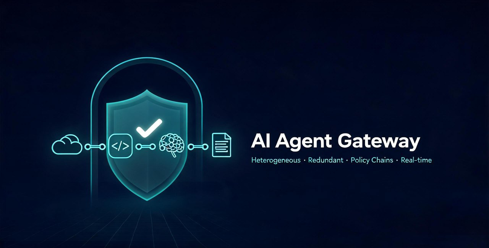

# AI Agent Gateway

> A **heterogeneous and redundant** content-security inspection gateway for
> Large Language Model (LLM) interactions. It orchestrates detection models
> from multiple sources and in multiple forms behind a unified REST API,
> chaining them as policies to inspect AI application inputs and outputs.

[简体中文](README.md) | English

---

## Table of Contents

- [Introduction](#introduction)
- [Features](#features)
- [Architecture](#architecture)
- [Quick Start](#quick-start)
- [API Example](#api-example)
- [Configuration](#configuration)
- [Live Dashboard](#live-dashboard)
- [Project Layout](#project-layout)
- [Testing](#testing)
- [Tech Stack](#tech-stack)
- [Documentation](#documentation)
- [Acceptable Use Policy](#acceptable-use-policy)
- [Disclaimer](#disclaimer)
- [Acknowledgments](#acknowledgments)
- [License](#license)

---

## Introduction

AI Agent Gateway is a production-oriented guardrail system for LLM interaction safety. It provides detection-capability management, policy orchestration, policy-chain execution, real-time observability, and a live monitoring dashboard. An AI application only needs to call a single endpoint, `POST /guard{path}`, to validate content before sending it to a model (input guard) or after receiving a reply (output guard).

The system consists of three parts:

- **Admin console**: configure detection models, safety tags, policies, and external detection paths. Changes take effect immediately without restarting.
- **Detection API**: a unified entry point with API Key authentication and a customizable block status code, easy to integrate with AI gateways such as Higress and with business systems.
- **Live dashboard**: WebSocket-pushed detection events visualizing the policy chain and per-model verdicts in real time.

## Features

- **Heterogeneous**: A single policy can mount detectors of heterogeneous origins — standard REST detection services (self-built HTTP APIs), local open models wrapped as REST services in Python (see [guardrail/](guardrail/)), and inline Python scripts — all managed and mixed in one place.
- **Redundant**:
  - **Sequential detection**: detectors in the model pool are invoked one by one; the first unsafe verdict fails fast and cancels remaining calls, balancing latency and recall.
  - **Random detection**: one detector is chosen at random from a pool of interchangeable, redundant models, delivering an unpredictable protection surface at a fixed low cost and raising the bar for evasion.
- **Policy chains**: One external path can bind multiple policies in order (e.g., PII → jailbreak → inappropriate content); any failed policy blocks the request.
- **Real-time observability**: Full request-level and model-invocation-level logs (with latency), WebSocket event streaming, a built-in dashboard, and statistics views.
- **Gateway ecosystem integration**: Ships a Go/Wasm plugin for the [Higress](https://higress.io/) AI gateway (see [plugins/](plugins/)) for transparent in-gateway enforcement.

## Architecture

```
┌─────────────┐
│  AI App     │ ──request──▶  ┌────────────────────────────────┐
│ (integrator)│               │      AI Agent Gateway          │
└─────────────┘               │                                │
                              │  ┌─────────────────────────┐  │
                              │  │  Policy chain (ordered) │  │
                              │  │  ├─ Policy 1 (seq/rand) │  │
                              │  │  │   ├─ Model A (REST)  │  │
                              │  │  │   ├─ Model B (script)│  │
                              │  │  │   └─ Model C (REST)  │  │
                              │  │  ├─ Policy 2 (seq/rand) │  │
                              │  │  └─ Policy 3 (seq/rand) │  │
                              │  └─────────────────────────┘  │
                              │                                │
                              │  ◀── observability + dashboard │
                              └────────────────────────────────┘
                                          │
                                          ▼
                                     PostgreSQL
```

### Core concepts

- **Safety tag**: a detector category, such as "PII detection" or "jailbreak detection". Six built-in tags; custom tags supported.
- **Detection model**: an external or custom safety service that can bind multiple tags. Two access types: REST endpoint and Python script.
- **Policy**: the ordered model pool for a given tag plus an invocation rule (sequential / random), a maximum wait time, and a per-model timeout policy.
- **API path (detection scenario)**: an externally exposed detection endpoint that binds an ordered chain of policies and an API Key.

## Quick Start

### Requirements

- Python 3.10+
- Node.js 20+
- Docker (optional, for containerized deployment)

### Local development (frontend + backend)

```bash
# 1. Clone
git clone <repo-url>
cd ai-agent-gateway

# 2. Build (install backend deps + build frontend)
bash scripts/build.sh

# 3. Start dev servers (backend :8000, frontend :5173)
bash scripts/start.sh
```

URLs:

- Admin console: http://localhost:5173
- API docs (Swagger UI): http://localhost:8000/docs
- Live dashboard: http://localhost:5173/#/dashboard

Default administrator: `admin` / `admin123` (change it immediately in production).

### Docker one-click deployment (recommended for production)

```bash
# 1. Copy and edit configuration (DB password, SECRET_KEY, admin password, etc.)
cp .env.example .env
vim .env

# 2. Deploy (build image + start PostgreSQL and gateway containers)
bash scripts/deploy-docker.sh
```

Open http://localhost:8000 (console, API docs, and dashboard share the port).

## API Example

The unified endpoint is `POST /guard{path}`, where `{path}` is configured in the admin console under "Detection Scenarios".

```bash
curl -X POST http://localhost:8000/guard/chat-input \
  -H "Content-Type: application/json" \
  -H "X-API-Key: gk_xxxxxxxxxxxxxxxxxxxxxxx" \
  -d '{
    "messages": "the user input to inspect",
    "jsonpath": "",
    "illegal_status_code": 200
  }'
```

**Request fields**

| Field | Type | Required | Description |
|-------|------|----------|-------------|
| `messages` | string | yes | The message to inspect (plain text, or a JSON string used together with `jsonpath`) |
| `jsonpath` | string | no | JsonPath extracting the content to inspect; empty means the whole message |
| `illegal_status_code` | int | no | HTTP status code returned when unsafe; default `200` (distinguished via the body code) |

**Safe response**

```json
{
  "code": 200,
  "risk_level": "NONE",
  "message": "Passed, no security risk detected",
  "risk_type": ""
}
```

**Unsafe response**

```json
{
  "code": 4030,
  "risk_level": "HIGH",
  "message": "Content contains sensitive material",
  "risk_type": "PII detection"
}
```

Business codes:

| `code` | Meaning |
|--------|---------|
| `200` | Passed (safe) |
| `4030` | Risk detected (unsafe) |
| `4001` | JsonPath extraction failed (message is not valid JSON or path did not match) |

The HTTP status code follows `illegal_status_code`; authentication failures return `401`, disabled paths/keys return `403`, and unknown paths return `404`.

### Admin API

Admin APIs require JWT authentication: obtain a token from the login endpoint and send the `Authorization: Bearer <token>` header. See the API docs at http://localhost:8000/docs .

## Configuration

### Environment variables

For local development use the template at [backend/.env.example](backend/.env.example); Docker Compose deployments use the root-level [.env.example](.env.example).

| Variable | Description | Default |
|----------|-------------|---------|
| `GATEWAY_HOST` | Bind host | `0.0.0.0` |
| `GATEWAY_PORT` | Bind port | `8000` |
| `DATABASE_URL` | Database connection URL | `sqlite:///./guardrail.db` |
| `SECRET_KEY` | JWT signing secret | **must change in production** |
| `ACCESS_TOKEN_EXPIRE_MINUTES` | Login token TTL (minutes) | `720` |
| `ADMIN_USERNAME` | Default admin username | `admin` |
| `ADMIN_PASSWORD` | Default admin password | `admin123` |
| `OBSERVABILITY_LEVEL` | Observability level (debug/basic/statistics) | `basic` |
| `CORS_ORIGINS` | Allowed CORS origins | `*` |
| `POSTGRES_USER` / `POSTGRES_PASSWORD` / `POSTGRES_DB` | PostgreSQL account and database name for Docker deployment (see root template) | `guardrail` / see template |

> **Production security reminder**: Before going live, be sure to replace the default admin password `admin123` and the weak `SECRET_KEY` placeholder, and tighten `CORS_ORIGINS` from `*` to specific domains.

### Adding a detector

#### REST endpoint

1. Create a model under "Detection Capabilities" and choose "REST endpoint";
2. Fill in the URL, HTTP method, headers, and request-body template (the `{content}` placeholder is replaced with the actual inspected content);
3. Configure the safe verdict: the response status code equals a specified value, and/or a value extracted from the response body via JsonPath equals the expected string (case-insensitive);
4. Configure the JsonPath extraction path for the unsafe-message text;
5. Click "Validity check" to verify connectivity.

Request-body template example:

```json
{
  "text": "{content}"
}
```

#### Python script

1. Create a model and choose "Python script";
2. Script contract: define a `detect(content)` function returning `(code, message)`; `code == 0` means safe, any other value means unsafe, and `message` is the warning message when unsafe;
3. Scripts run in an isolated subprocess with a timeout, separate from the main service process.

> **Security reminder**: Scripts are actually executed. Ensure they are submitted only by trusted administrators to avoid arbitrary code execution risks.

```python
def detect(content):
    if "forbidden" in content:
        return 1, "Content contains forbidden material"
    return 0, ""
```

> For example scripts that wrap local open detection models (e.g., Qwen3Guard, Llama Prompt Guard) as REST services, see the [guardrail/](guardrail/) directory.

## Live Dashboard

The dashboard pushes four types of detection events in real time via WebSocket (`/ws/dashboard`): `request_received`, `strategy_start`, `strategy_result`, and `final_result`, presenting:

- Cumulative statistics, the 7-day trend, and risk-type distribution;
- Real-time interaction flow (AI app ⇄ gateway ⇄ policy chain ⇄ detection models);
- The execution process of the policy chain and each model's individual verdict;
- Event stream (request arrival, strategy execution, final result).

Access: local development http://localhost:5173/#/dashboard ; Docker deployment http://localhost:8000/#/dashboard .

## Project Layout

```
.
├── backend/                  # FastAPI + SQLAlchemy backend
│   ├── app/
│   │   ├── api/              # Route controllers
│   │   ├── core/             # Config, database, auth/security
│   │   ├── models/           # ORM models
│   │   ├── schemas/          # Pydantic schemas
│   │   ├── services/         # Model invoker, strategy engine, gateway, broadcaster
│   │   └── main.py           # Application entry
│   ├── scripts/smoke_test.py # End-to-end smoke test
│   └── requirements.txt
├── frontend/                 # Frontend (Vue 3 + Vite + Pinia + ECharts)
│   └── src/
│       ├── api/  components/  router/  stores/  styles/  views/
├── guardrail/                # Python scripts exposing detection models as REST APIs (Qwen3Guard / Prompt Guard)
│   ├── qwen3-guard.py
│   ├── meta-prompt-guard.py
│   ├── start-all.sh / stop-all.sh
│   └── README.md
├── plugins/                  # AI-gateway plugins
│   └── higress/              # Higress Go/Wasm plugin
│       └── content-security-guard/
│           └── README.md
├── scripts/                  # One-click build / start / Docker deploy scripts
├── docs/                     # Architecture design and integration guides
├── Dockerfile                # Multi-stage single-image build
├── docker-compose.yml        # PostgreSQL + gateway orchestration
└── .env.example              # Docker deployment environment-variable template
```

## Testing

```bash
cd backend
python3 scripts/smoke_test.py
```

The smoke test covers login/auth, model management and validity checks, policy orchestration, API paths and keys, detection flows (safe / unsafe / JsonPath failure), and observability stats and logs.

## Tech Stack

- **Backend**: FastAPI, SQLAlchemy 2.x, Pydantic, PyJWT, httpx, jsonpath-ng, Uvicorn
- **Frontend**: Vue 3, Vue Router, Pinia, Axios, ECharts, Vite
- **Detection side**: Python, Flask, PyTorch, Transformers, ModelScope
- **Gateway plugin**: Go, Higress proxy-wasm-go-sdk
- **Database**: SQLite (local) / PostgreSQL (production)
- **Deployment**: Docker, Docker Compose

## Documentation

- [System Architecture & Design Principles](docs/ARCHITECTURE.md)
- [API Integration Guide](docs/INTEGRATION.md)
- [Guardrail model scripts](guardrail/README.md)
- [Higress plugin](plugins/higress/content-security-guard/README.md)

## Acceptable Use Policy

This project is provided **exclusively for lawful** content-security research, education, and defensive purposes, to help researchers and developers evaluate and improve the safety of AI applications. By using this project (including any model integrated with it), you agree to:

1. Comply with the laws and regulations of your jurisdiction, including data-protection and privacy requirements;
2. Only inspect data and systems you are legally authorized to use; do not infringe others' rights or circumvent safety controls;
3. Not use this project to generate or distribute illegal content, or to perform unauthorized testing or attacks against third-party systems;
4. Conduct your own legal, security, and quality review before any production or commercial use, and bear responsibility for such use.

You are solely responsible for any consequences of misuse; the authors and contributors accept no liability.

## Disclaimer

This project is provided "AS IS", without any express or implied warranties, including but not limited to warranties of merchantability, fitness for a particular purpose, and non-infringement. In no event shall the authors or contributors be liable for any direct, indirect, incidental, special, or consequential damages arising from the use of this project.

The outputs of integrated safety-detection models are automatically generated and may contain false positives, false negatives, or deviations. They **do not constitute professional security assessments, legal opinions, or compliance conclusions**. You must make independent judgments and bear all risks of relying on such outputs.

## Acknowledgments

This project stands on the shoulders of the open-source community. Sincere thanks to the authors and contributors of the following projects and models. All third-party components and models remain the property of their respective copyright holders and are governed by their own licenses:

**Open models**

- [Qwen3Guard](https://github.com/QwenLM/Qwen3Guard) (Qwen Team) — content-safety guard model
- [Llama Prompt Guard 2](https://www.llama.com/models/) (Meta) — prompt-injection / jailbreak detector (obtained via ModelScope `LLM-Research/Llama-Prompt-Guard-2-86M`)

**Third-party frameworks and components**

- [FastAPI](https://github.com/fastapi/fastapi), [Uvicorn](https://github.com/encode/uvicorn), [Pydantic](https://github.com/pydantic/pydantic), [SQLAlchemy](https://github.com/sqlalchemy/sqlalchemy), [PyJWT](https://github.com/jpadilla/pyjwt), [httpx](https://github.com/encode/httpx), [jsonpath-ng](https://github.com/h2non/jsonpath-ng)
- [Vue 3](https://github.com/vuejs/core), [Vite](https://github.com/vitejs/vite), [Vue Router](https://github.com/vuejs/router), [Pinia](https://github.com/vuejs/pinia), [Axios](https://github.com/axios/axios), [ECharts](https://github.com/apache/echarts)
- [Flask](https://github.com/pallets/flask), [PyTorch](https://github.com/pytorch/pytorch), [Transformers](https://github.com/huggingface/transformers), [ModelScope](https://github.com/modelscope/modelscope)
- [Higress](https://github.com/alibaba/higress) with [proxy-wasm-go-sdk](https://github.com/higress-group/proxy-wasm-go-sdk), [wasm-go](https://github.com/higress-group/wasm-go), [gjson](https://github.com/tidwall/gjson)
- [PostgreSQL](https://www.postgresql.org/), [Docker](https://www.docker.com/), [Swagger UI](https://github.com/swagger-api/swagger-ui), [ReDoc](https://github.com/Redocly/redoc)

This list may not be exhaustive; thanks also to every indirectly referenced open-source project and its community. If your work is referenced by this project but missing from this list, or any statement needs correction, please let us know via an issue.

## License

- The project's own code is released for **research purposes only** under the [LICENSE](LICENSE) (Research-Only License). Commercial use, production operation, or redistribution requires prior written permission from the copyright holders.
- All third-party open-source components and models referenced, depended on, or bundled with this project (see [Acknowledgments](#acknowledgments)) are **owned by their respective copyright holders** and remain under their own licenses (including model licenses and usage policies). Read and comply with those terms before use.
- No third-party trademark or brand rights are conveyed by this project.
